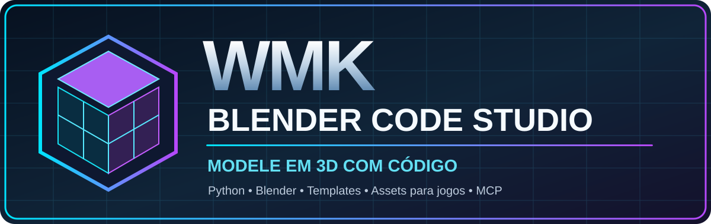

<div align="center">



</div>

<div align="center">

# WMK Blender Code Studio

### Aprenda a modelar no Blender usando Python — do primeiro cubo aos assets para jogos

**Projeto gratuito e de código aberto · Licença MIT · Documentação em português**

**Walney Moreira Klein — walneyk@hotmail.com**

</div>

> **Dois projetos em um repositório:** o **MCP for Blender** original continua na raiz e funciona independentemente. O **WMK Blender Code Studio** é uma interface Web complementar, planejada para residir na pasta `studio/`. Não exclua os arquivos `src/`, `addon.py`, `pyproject.toml` ou outros componentes do MCP.

## O que é?

Se você sabe programar, mas ainda não sabe modelar, este projeto foi pensado para você. O objetivo é transformar operações de modelagem em **código Python (`bpy`)**, com uma biblioteca de templates paramétricos, editor de código e integração opcional com o Blender em execução.

O projeto se divide em:

| Componente | Função | Precisa de IA? |
|---|---|---|
| **MCP for Blender** | Conecta o Blender a clientes MCP, como Codex e Cursor | Não para instalar; o cliente de IA é opcional |
| **WMK Blender Code Studio** | Interface Web com templates, parâmetros e código Python | **Não** |
| **Blender** | Cria e edita os modelos 3D | **Não** |

## Estado do projeto

- ✅ **MCP original**: código e documentação preservados no repositório.
- ✅ **Documentação integrada**: README, guias de instalação e configuração de clientes MCP.
- 🧪 **Studio Web v1.1.1**: aplicação de desenvolvimento disponível em pacote de distribuição local, com 40 templates; a publicação integral do código da pasta `studio/` no GitHub será identificada separadamente quando concluída.
- 🧪 **Execução via ponte PHP**: requer Blender aberto, complemento MCP ativo em `127.0.0.1:9876` e teste na máquina do usuário.
- ❌ **Servidor público / nuvem**: não há hospedagem pública da execução Python. Não exponha a ponte PHP ou a porta MCP à Internet.

**Não confunda o fork MCP com a distribuição Web:** até a pasta `studio/` estar totalmente publicada, o botão `Code → Download ZIP` do GitHub não representa a versão completa do Studio.

## Como instalar o MCP original

Leia o [README preservado do MCP](README-MCP-ORIGINAL.md), incluindo requisitos, compatibilidade e comandos atualizados.

Em resumo:
1. Instale o [Blender](https://www.blender.org/) e o [uv](https://docs.astral.sh/uv/).
2. Configure o servidor MCP no cliente de sua preferência.
3. Instale e ative o add-on `MCP for Blender` no Blender.
4. Abra a barra lateral do Blender com a tecla `N`, localize a aba MCP e confirme que o servidor está ativo.
5. Teste primeiro a leitura da cena e só depois a criação de objetos.

Veja o [guia passo a passo para VS Code/Codex/Cursor e outros clientes](docs/INTEGRACAO-IAS.md).

## Como executar o WMK Blender Code Studio

A versão Web, quando instalada a partir do **pacote completo do Studio**, pode ser executada por:

### Opção A — XAMPP (Windows)

1. Instale XAMPP com PHP 8.1 ou superior.
2. Copie a pasta da aplicação para `C:\xampp\htdocs\WMK-Blender-Code-Studio\`.
3. Inicie o Apache no painel do XAMPP.
4. Abra `http://localhost/WMK-Blender-Code-Studio/`.
5. Escolha um template e confira se o código Python aparece antes de tentar executar.
6. Abra o Blender e habilite o MCP caso queira enviar comandos pela ponte local.

### Opção B — Servidor PHP integrado

Abra o terminal na pasta da aplicação Web e execute:

```powershell
php -S 127.0.0.1:8000
```

Acesse `http://127.0.0.1:8000/`.

**Importante:** `php -S` é voltado a desenvolvimento local, não é uma solução de hospedagem pública segura.

## Primeira experiência sem MCP ou IA

1. Abra o Blender e salve uma cena de teste.
2. Vá para **Scripting → New**.
3. Cole o exemplo abaixo:

```python
import bpy

bpy.ops.mesh.primitive_cube_add(size=2, location=(0, 0, 1))
obj = bpy.context.object
obj.name = "WMK_Meu_Primeiro_Cubo"
```

4. Execute usando **Run Script** (`Alt + P` com o cursor sobre o editor).
5. No **Outliner**, encontre `WMK_Meu_Primeiro_Cubo`.

Pronto: você modelou seu primeiro objeto por código!

## Demonstração real: template Toro criado no Blender

As capturas de uma sessão de testes mostram o **WMK Blender Code Studio gerando código Python para o template Toro**, recebendo resposta de execução e o objeto **`WMK_Toro`** presente na cena do **Blender 5.2.3 LTS**.

**Sequência:** Marketplace → Editor Python (72 linhas) → Confirmar execução → Blender exibe `WMK_Toro` na coleção `WMK_LAB_toro`.

📸 **[Veja o relatório da demonstração e o roteiro para reproduzir](docs/DEMONSTRACOES-REAIS.md).** As seis capturas reais estão preparadas para inclusão em `docs/screenshots/`; os arquivos de imagem precisam ser enviados ao GitHub antes que possam aparecer embutidos aqui.

> Este é um teste **do template Toro**, não uma certificação dos 40 templates. A integração usa o complemento MCP ativo na porta local 9876 e PHP com extensão `sockets`.

## Segurança

- Sempre faça backup do arquivo `.blend` antes de executar um script.
- O `bpy` tem acesso à cena e pode interagir com o sistema de arquivos. Nunca execute scripts desconhecidos sem revisar.
- Mantenha a integração em `127.0.0.1` e não exponha `9876` ou os endpoints PHP à rede.
- A ponte Web deve validar templates e parâmetros; **não execute código arbitrário do Monaco por uma API pública**.
- Guarde históricos, templates e backups antes de atualizar versões.

## Documentação

- [README original do MCP](README-MCP-ORIGINAL.md)
- [Instalação do Studio no XAMPP e PHP](docs/INSTALACAO-STUDIO.md)
- [Configuração do MCP em Codex, VS Code, Cursor e outros](docs/INTEGRACAO-IAS.md)
- [Ideias e roadmap dos dois componentes](docs/ROADMAP-WMK.md)

## Licença e autores

**Licença MIT.** O MCP for Blender tem como autor original **Siddharth Ahuja (2025)** e colaboradores; preserve seus direitos e avisos legais no [LICENSE](LICENSE). A integração, documentação e contribuições do WMK Blender Code Studio são creditadas a **Walney Moreira Klein — walneyk@hotmail.com**, sem remover a atribuição original.

O projeto não é afiliado nem endossado pela Blender Foundation.

---

**WMK — Programação também é modelagem 3D.**
